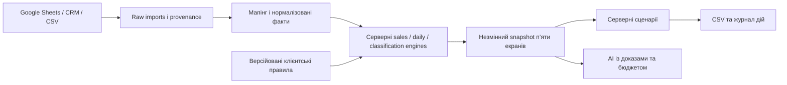

# MXMT Analytics

Мультитенантний застосунок для мерчандайзингу: продажі, маржа, запаси, переоцінка та дозамовлення. Дані з Google Sheets і CRM/commerce-конекторів проходять нормалізацію та спільні серверні розрахунки; AI пояснює збережені факти, а не обчислює фінансові показники.

Оновлено **30 жовтня 2026 року** за кодом цієї гілки. Наявність реалізації не означає активацію конкретного клієнта або завершене production-приймання.

- [Інструкція користувача](INSTRUCTIONS.md) — підключення, п’ять екранів і щоденні дії.
- [Операційний runbook](RUNBOOK.md) — деплой, міграції, worker, інциденти та відновлення.
- [Звіт оновлення залежностей](prisma/verification/dependency-upgrade/report.md) — версії, сумісність, перевірки й обмеження.

## Поточний продукт

### П’ять основних екранів MVP

| Розділ | URL | Призначення |
| --- | --- | --- |
| Огляд | `/overview` | KPI, підсумки та переходи до дій O1–O8 |
| Продажі | `/sales` | Продажі, покрита маржа, канали, категорії й порівняння з минулим роком S1–S4 |
| Склад | `/stock` | Структура запасу, категорії, бренди, класифікація та фактична історія K1–K4 |
| Переоцінка | `/repricing` | Серверні сценарії R1–R4, фільтри, параметри та ручні ціни |
| Дозамовлення | `/reordering` | Рекомендовані кількості, умови постачання та групи постачальник/валюта |

Спільні фільтри зберігаються в URL. Drill-down переносить період, джерело контексту та потрібний піднабір SKU. Продажі фільтруються за каналом; спільні залишки залишаються за всіма каналами. Звіти використовують версійований snapshot із фіксованими розрахунками та налаштуваннями, щоб KPI і деталізація були узгоджені.

`/settings` містить вкладки **Загальне**, **Мерчандайзинг**, **Агенти**. Тут налаштовуються підключення, вибір джерела MVP, мапінг Sheets, Data Quality, клієнтські правила, бренди, постачальники й категорії.

### Збережені додаткові модулі

У меню **Інші інструменти** залишаються `/dashboard`, `/agents`, `/calendar`, `/analyst`, `/assortment`, `/data-reporting`. Кореневий маршрут і поточний login/register усе ще ведуть на `/dashboard`; основний MVP відкривається через меню **Огляд**. Старі калькулятори та дев’ять агентів не були автоматично переведені на новий контракт.

`/data-reporting` показує вихідні дані та попередні розрахункові вкладки. Його перемикач **Google Sheets / SalesDrive** змінює представлення сторінки, а не обране джерело п’яти MVP-екранів.

## Джерела і готовність даних

| Джерело | Реалізація | Що потрібно перед використанням |
| --- | --- | --- |
| Google Sheets | Raw snapshot → погоджений мапінг → явна проєкція в спільні факти | Доступ до файлу, реальні правила ідентичності/статусів/сум/дат, approval, вибір джерела, MVP refresh |
| SalesDrive | Замовлення та incremental changes, YML-каталог, підтверджені надходження, спостереження цін/залишків | Read-доступи, перевірка підключення, мапінг, імпорт, external worker для автоматики |
| CSV | Версійований ручний пакет, preview, activation, durable jobs | UTF-8 файли, явні колонки/політики та перевірена історична повнота; автоматичного polling немає |
| KeyCRM | Read-конектор та Settings onboarding | Погоджені поля, account permissions, статуси, ціни/оплати/склад і перевірка реального акаунта |
| Horoshop | Read-конектор із full-rescan та захистом HTTPS origin/DNS | Точний дозволений origin, account evidence, мапінг і canary |
| Shopify | Read GraphQL-конектор, durable cursors і query-cost budget | Погоджена версія/scopes, оплати/повернення, валюта, склад і перевірка реального магазину |

Збереження credentials не вибирає нове джерело звітів. Вибір виконує ADMIN у Settings і створює нову revision. Сумування різних провайдерів, об’єднання дубльованих замовлень між CRM і магазином та FX-конвертація не виконуються. Для сумісності кабінет без явного вибору може зберігати попереднє SalesDrive-джерело; його фактичну готовність все одно треба перевірити.

Можливі стани джерела: `CONNECTION_CHECK_REQUIRED`, `MAPPING_REQUIRED`, `IMPORT_REQUIRED`, `READY`. `READY` підтверджує готовність входів, а не повну історію, наявність собівартості чи право виконати будь-яку рекомендацію.

### Спільний pipeline



- Tenant і роль беруться з підписаної сесії; бізнес-зв’язки також обмежені tenant/source у БД.
- Нові грошові факти використовують Decimal. Валюти відображаються окремо; невідоме значення не підміняється нулем.
- Виручка, покритий GP, LY, швидкість, WOH, STR, availability та SKU-класифікація рахуються на сервері з версіями входів і налаштувань.
- Час завантаження не доводить історичний залишок або дату повернення. Історія складу містить лише реальні датовані спостереження.
- Незавершена класифікація має стан partial/unavailable, а не неправдивий нуль неліквіду чи відсутність дефіциту.
- Успішний експорт зберігає точні байти файлу, параметри, автора, snapshot і hash. Він не змінює ціни в CRM і не надсилає замовлення постачальнику.

## Технологічний стек

Версії нижче — прийнятий lockfile на дату оновлення, а не обіцянка незмінного `latest`.

| Компонент | Версія / реалізація |
| --- | --- |
| Runtime | Node 24 LTS; `.nvmrc` — 24.22.2; npm 11.19.1 |
| Framework | Next.js 16.4.3, App Router, React / React DOM 19.3.1, Turbopack |
| Мова | TypeScript 7.0.2, strict |
| Database | PostgreSQL; production topology — Neon |
| ORM | Prisma CLI / Client / `@prisma/adapter-pg` 7.10.1 |
| CSS | Tailwind 4.3.3, `@tailwindcss/postcss`, tailwind-merge 3.7.0 |
| Auth | `proxy.ts`, JWT у httpOnly cookies, jose 6.2.14, bcryptjs 3.0.3 |
| AI SDK | Anthropic 1.3.0, OpenAI 7.45.1 |
| Таблиці | SheetJS 0.20.3 з офіційного tarball + спільний compatibility reader |
| Тести | Vitest 5.0.5 / Vite 8.3.5; PGlite 0.5.13 для ізольованих SQL-fixtures |
| Іконки | Lucide React 1.64.0 |

Tailwind theme міститься в `app/globals.css`, PostCSS integration — у `postcss.config.mjs`; `tailwind.config.ts` більше немає. Мінімальні браузери: Safari 16.4, Chrome 111, Firefox 128 ([офіційний upgrade guide](https://tailwindcss.com/docs/upgrade-guide)).

## Структура репозиторію

```text
app/(app)/                 захищені MVP та додаткові сторінки
app/(auth)/                login / register
app/api/                   auth, connectors, merchandising, legacy API
components/                повторно використовуваний UI
lib/connectors/            onboarding, source selection, jobs, adapters, Sheets projection
lib/ai-execution/          версійований AI context та usage ledger
lib/                       розрахунки, snapshots, сценарії, exports, audit
prisma/schema.prisma       моделі PostgreSQL
prisma/migrations/         незмінна історія застосованих міграцій
prisma/verification/       tracked контракти, перевірки й activation boundaries
prisma.config.ts           Prisma CLI config; direct datasource і env loading
proxy.ts                   Next.js 16 auth/redirect proxy
scripts/                   DB lifecycle, external worker, offline verification
tests/                     unit, API та SQL integration fixtures
```

## Локальний запуск

Потрібні Node з `.nvmrc`, npm із `packageManager`, PostgreSQL із відомим target і унікальні JWT secrets. Google/CRM/AI доступи потрібні лише для відповідних функцій; звичайні synthetic-тести їх не потребують.

```sh
git clone <repository-url>
cd mxmt
nvm install
nvm use
node --version
npm --version
npm ci
cp .env.example .env.local
```

У `.env.local` задайте `DATABASE_URL`, `DIRECT_URL`, JWT secrets та потрібні інтеграції. Приберіть шаблонний `NODE_ENV="production"` із локальної копії: `next dev` сам встановлює development. Не залишайте placeholder Google/AI keys як нібито чинні credentials.

Обидва DB URL мають вказувати на **одну й ту саму** БД/schema; для локального PostgreSQL вони можуть збігатися. Перед наступною командою перевірте, що це ваша локальна/ізольована development-БД: `db:migrate:deploy` змінює її схему.

```sh
npm run db:migrate:deploy
npm run db:check
npm run dev
```

Адреса: `http://localhost:3000`. Створіть окремий тестовий кабінет через `/register`. Не додавайте спільний пароль або реальні credentials до документації/fixtures.

### Команди

| Команда | Поведінка |
| --- | --- |
| `npm ci` | Встановлює прийнятий lockfile; postinstall генерує Prisma Client |
| `npm run dev` | Спочатку `predev` перевіряє migration history, потім запускає Next |
| `npm run build` | Генерація Client і Next production build; не перевіряє/не застосовує міграції |
| `npm run build:vercel` | Перевірка DB target і migration status → Client → Next build |
| `npm start` | `prestart` перевіряє БД у production env, потім запускає зібраний застосунок |
| `npm run db:check` | Перевіряє однаковий DB target і migration history; нічого не застосовує |
| `npm run db:migrate -- --name describe_change` | Створює/застосовує development migration на відповідній development-БД |
| `npm run db:migrate:deploy` | Застосовує готові pending migrations до явно обраної БД |
| `npm run db:push` | Лише disposable development; не release workflow |
| `npm run db:studio` | Prisma Studio для налаштованого direct target |
| `npm test -- --maxWorkers=2` | Повний synthetic regression suite |
| `npm run test:mvp` | MVP ingestion / calculations / screens / scenarios / isolation |
| `npm run test:watch` | Watch mode |
| `npm run audit:zavod -- <workbook> --out <private-report>` | Офлайн-аудит файлу; точні параметри — [контракт звірки](prisma/verification/38-zavod-reconciliation.md) |
| `npm run reconcile:zavod -- <manifest> --out <private-report>` | Звірка замороженого пакета та approvals |
| `npm run verify:reporting:offline -- <workbook.xlsx> <private-report.json>` | Private-workbook і synthetic Sheets/SalesDrive parity без live-активації |

## Конфігурація і секрети

Повний шаблон — [`.env.example`](.env.example). `.env.local` та environment-specific файли завантажуються за правилами Next; Prisma CLI повторює їхню precedence через `@next/env` у `prisma.config.ts`.

| Змінна | Коли потрібна / призначення |
| --- | --- |
| `DATABASE_URL` | Runtime PostgreSQL; для Neon pooled endpoint з `-pooler` |
| `DIRECT_URL` | Direct endpoint тієї самої БД для Prisma CLI/migrations |
| `JWT_ACCESS_SECRET`, `JWT_REFRESH_SECRET` | Незалежні server-only секрети; обов’язкові для production |
| `CONNECTOR_ENCRYPTION_KEY` | 32 випадкових байти в base64; потрібен для збереження/читання encrypted connector config, включно з CSV metadata |
| `GOOGLE_DRIVE_FILE_ID` | Файл для Sheets/legacy Drive paths, а не універсальна вимога для всіх провайдерів |
| `GOOGLE_SERVICE_ACCOUNT_KEY` | Base64 JSON Service Account для приватного файлу; без нього використовується public-read path |
| `GOOGLE_DRIVE_EXPORT_FOLDER_ID` | Необов’язкова папка legacy exports; не вибирає джерело MVP |
| `CRON_SECRET` | Bearer-авторизація daily cron і external worker; щонайменше 16 символів, генеруйте випадковий secret |
| `SALESDRIVE_WEBHOOK_SECRET` | Окремий server-only secret для trusted relay та source-scoped bearer tokens |
| `HOROSHOP_ALLOWED_ORIGINS` | Точні перевірені HTTPS origins; без wildcard/path |
| `AI_PROVIDER`, `AI_TIMEOUT_MS` | Глобальний legacy provider і timeout |
| `ANTHROPIC_API_KEY`, `OPENAI_API_KEY` | Для обраного AI provider; v2 також потребує окремого схваленого бюджету |
| `MVP_NAVIGATION_ENABLED`, `LEGACY_NAVIGATION_ENABLED` | Лише видимість меню; не контроль доступу |
| `NEXT_PUBLIC_APP_URL` | Публічний URL застосунку; жодних server secrets із `NEXT_PUBLIC_` |

`SALESDRIVE_SYNC_ORIGIN` і `CRON_SECRET` задаються також у secret environment **зовнішнього worker host**, якщо він використовується. CRM credentials вводить ADMIN у Settings; вони шифруються з прив’язкою до tenant/provider і не повертаються браузеру як відкритий config. Втрата encryption key робить збережений config нечитабельним; rotation потребує окремого плану.

## Prisma 7, БД і deployment

`prisma/schema.prisma` описує provider/models; URL для CLI задає `prisma.config.ts` через `DIRECT_URL`. Runtime створює `PrismaPg` у `lib/prisma.ts` із `DATABASE_URL`; `lib/prisma-pool.ts` переносить pool-параметри. Не повертайте Prisma 5 `url/directUrl` у schema і не створюйте Client без adapter.

Для Neon використовуйте TLS і відповідні pooled/direct endpoints тієї самої branch/database/schema. Не вимикайте перевірку сертифікатів для усунення connection error. `db:check` перевіряє migration history, але не доводить відсутність ручного schema drift. P2022 / відсутня `Sku.catalogAttributes` потребує перевірки повної історії на точному target, а не лише `prisma generate`.

Deployment topology: Vercel application/API, Neon PostgreSQL, окремий external sync worker на погодженому Hobby-плані. Repository build command у `vercel.json` — **`npm run build:vercel`**. Pending migrations застосовуються окремим release-кроком після rehearsal на копії; build/startup не мігрують production автоматично.

Node engines обмежено `24.x`. Vercel підтримує Node 24, але exact patch у hosting може відрізнятися від `.nvmrc`; перевірте фактичні build/runtime logs ([правила Vercel](https://vercel.com/docs/functions/runtimes/node-js/node-js-versions)). Merge у `main` може запустити production Git deployment, якщо integration активна. Порядок release, workers і rollback — у [RUNBOOK](RUNBOOK.md).

## Планування синхронізації

- `vercel.json` має два daily Sheets slots: `/api/cron/data-import/utc-04` о `0 4 * * *` та `/utc-05` о `0 5 * * *`. Local-time gate залишає вікно 07:00–07:59 `Europe/Kyiv`; інший DST slot пропускається. Це заплановане вікно, не гарантія успішного імпорту.
- Daily Sheets import не позичає ADMIN identity для автоматичного погодження мапінгу чи MVP-проєкції. Після нових raw даних потрібен явний **Refresh MVP reports**.
- Trusted external scheduler викликає `GET /api/cron/salesdrive-sync` щохвилини з Bearer `CRON_SECRET`. Назва route історична; runtime обслуговує підтримані вибрані remote connectors і recalculation queue. CSV не опитується автоматично.
- Планувальник створює order intents за двогодинними UTC slots і stock intent після 03:00 за Києвом; один tick виконує обмежений крок. Черга, baseline/backfill, retry і фактична свіжість контролюються окремо.
- Native SalesDrive webhook без перевіреного relay не підключається напряму. Доставка через relay — сигнал до refetch, а не довірене джерело фінансових сум.

Деталі й recovery — [automatic sync](prisma/verification/32-automatic-sync.md), [provider runtime](prisma/verification/81-connector-foundation.md).

## Основні API boundaries

| Endpoint | Призначення / мінімальна роль |
| --- | --- |
| `GET/POST /api/connectors/source` | Читання вибору / ADMIN selection із revision |
| `GET/POST /api/connectors/<provider>` | Безпечні connection metadata / ADMIN save/check |
| `/api/connectors/sheets/mapping/<sourceId>` | ADMIN mapping metadata, окремі `/preview` та `/approve` |
| `GET/POST /api/connectors/sheets/projection/<sourceId>` | ADMIN fenced intent / явна publication |
| `POST /api/merchandising/snapshots` | VIEWER+ створення/повторне використання derived snapshot, без source activation |
| `GET /api/merchandising/<screen>` | VIEWER+ frozen report; потрібен `snapshotId` |
| `POST /api/merchandising/repricing/inputs` | VIEWER+ frozen inputs для preview |
| `POST /api/merchandising/repricing/preview`, `/reordering/preview` | VIEWER+ серверні сценарії |
| `GET/POST /api/merchandising/exports` | VIEWER+ receipt history / ANALYST+ generation; download окремим authorized route |
| `GET /api/data/quality` | Поточні tenant/source diagnostics; мутації мають окремий ADMIN gate |

Точні параметри й помилки визначають Route Handlers та [screen contract](prisma/verification/39-screen-apis.md). Не пересилайте всі UI query params до strict API. `tenantId`, роль, authoritative metrics, provider transport і secrets не є довіреними полями браузерного запиту. Бізнес-правила затверджені в [D01–D22 register](docs/mvp-business-decisions.md); це не approval конкретного customer mapping або live-активації.

## AI, v2 та зовнішні дії

| Можливість | Поточна межа |
| --- | --- |
| Evidence-backed chat | П’ять MVP topics, серверні fact cards і citations; ANALYST+, versioned context та окремо активований AI budget |
| Marketing briefs v2 | API/service для paid social, SMM і website; не новий workspace і не автоматична публікація |
| Meta/Google custom labels | Версійований preview/export/history; явні слоти й правила, ручний імпорт після перевірки provider contract |
| Product attributes | Словник і аналіз реальних source attributes; реальні samples/approval та активація відкладені |
| Market trends | Evidence/quota/retention mechanism; реальний постачальник, ліцензія, бюджет і активація не обрані |
| New-product forecast | Draft policy, approved-analog mechanism і backtest; правила/активація відкладені, автозамовлень немає |
| Retrospectives / GMROI | Evidence APIs, однакові повні before/after дні без дня запуску; observed own-stock approximation, без causal uplift |
| SalesDrive price write-back | Preview → approve → execute contract і fake transport; production transport відсутній, live-запис вимкнений |
| Supplier delivery | Preview → approve → send/cancellation contract і audit; live-канал/transport не підключено |

Новий AI budget не обмежує автоматично старі дев’ять AgentRun workflows. Missing/disabled v2 policy блокує provider call; API key сам по собі не активує платну capability. Зміна SDK не змінює погоджену модель; lifecycle/access моделей перевіряється перед live-використанням.

## Перевірки та статус приймання

```sh
npm ci
npx prisma validate
npx tsc --noEmit --incremental false
npm test -- --maxWorkers=2
npm run test:mvp
npm run build
npm audit
```

`build:vercel` перевіряйте окремо з обома URL **ізольованої migrated БД**. Звичайні тести використовують synthetic дані та PGlite; вони не доводять Neon/Vercel latency. Private-workbook test пропускається без явного офлайн-запуску. Не послаблюйте assertions/таймаути заради зеленого прогону.

На 30.10.2026 оновлений lockfile пройшов 1 651 тест (один існуючий optional skip), 965 MVP-тестів, обидві збірки та 84 окремі офлайн-перевірки Zavod; audit — 0 findings. MVP-набір перетинається з повним. [Validation evidence](prisma/verification/dependency-upgrade/final-validation.json) містить також початкові environmental timeouts і межі browser review.

**Повне customer acceptance не підтверджене.** Звірка Zavod, owner-approved джерела/правила, UAT, реальні account canaries, Bimba activation і production operational evidence залишаються окремими gates. Поточна динамічна таблиця не замінює заморожений dated benchmark. Попередня real-data five-screen PGlite-проєкція не завершилася в transaction budget; з цього не можна робити висновок про production PostgreSQL performance.

## Контракти і подальше читання

| Тема | Документ |
| --- | --- |
| Модель, provenance та isolation | [Data model](prisma/verification/README.md) |
| Підключення та додаткові providers | [Onboarding](prisma/verification/29-connector-onboarding.md), [CSV](prisma/verification/82-csv-connector.md), [KeyCRM](prisma/verification/83-keycrm-connector.md), [Horoshop](prisma/verification/84-horoshop-connector.md), [Shopify](prisma/verification/85-shopify-connector.md) |
| Нормалізація й налаштування | [Products](prisma/verification/33-product-normalization.md), [Settings](prisma/verification/34-merchandising-settings.md) |
| Серверні метрики | [Sales](prisma/verification/35-sales-financial-metrics.md), [Daily SKU](prisma/verification/36-daily-sku-metrics.md), [Classification](prisma/verification/37-sku-classification.md) |
| П’ять екранів і CSV | [Screen API](prisma/verification/39-screen-apis.md), [Repricing](prisma/verification/44-repricing-calculator.md), [Reordering](prisma/verification/46-reordering-calculator.md), [Exports](prisma/verification/48-scenario-csv-exports.md) |
| Sheets → MVP | [Mapping](prisma/verification/google-sheets-reporting-step-2.md), [Projection](prisma/verification/google-sheets-reporting-step-3.md), [Application flow](prisma/verification/google-sheets-reporting-step-4.md), [Offline acceptance](prisma/verification/google-sheets-reporting-step-6.md) |
| Якість і другий клієнт | [Data Quality](prisma/verification/49-settings-data-quality.md), [Bimba](prisma/verification/50-monobrand-onboarding.md) |
| AI та маркетинг | [Budgets](prisma/verification/93-ai-execution-context-budgets.md), [Chat](prisma/verification/94-evidence-backed-merchandising-chat.md), [Briefs](prisma/verification/95-versioned-marketing-briefs.md), [Labels](prisma/verification/96-custom-label-exports.md) |
| Evidence/forecast | [Attributes](prisma/verification/97-product-attribute-analysis.md), [Market evidence](prisma/verification/98-external-market-evidence.md), [Analogs](prisma/verification/99-new-product-analog-forecast.md) |
| Дії та ретроспективи | [GMROI](prisma/verification/108-retrospective-evidence-gmroi.md), [Price write-back](prisma/verification/109-salesdrive-price-writeback.md), [Supplier delivery](prisma/verification/110-supplier-order-delivery.md) |
| Release gates | [Zavod reconciliation](prisma/verification/38-zavod-reconciliation.md), [MVP acceptance](prisma/verification/51-mvp-acceptance-rollout.md), [DB readiness](prisma/verification/database-schema-startup.md) |

Ці tracked документи містять історичні validation snapshots своїх задач; для поточного toolchain використовуйте `package-lock.json`, цю інструкцію та фінальний dependency report. Старі посилання на Prisma 5 не означають дозвіл запускати старий CLI на новій схемі.

## Ліцензія та доступ

Приватний проєкт. Не публікуйте credentials, database dumps, реальні workbook/CSV exports, customer rows або AI prompts поза авторизованим контекстом.
